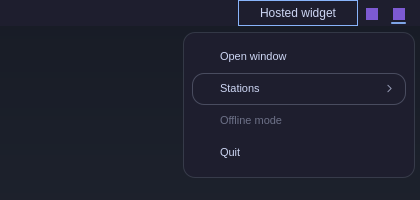

# Foamy Tray

Shows the whole active system tray in Omarchy Quattro, without a drawer or
pin/hide controls. App menus and nested submenus remain available.



## Install

```sh
omarchy plugin add https://github.com/foamrider/foamy-tray.git --enable
```

Remove the stock tray widget (or any other tray) from the bar layout, so icons
don't show twice. Supports horizontal and vertical bars on Omarchy 4.5 and
4.0.6. Apps marked passive do not appear.

On Omarchy 4.5, widgets in `bar.layout.tray` stay visible beside the
application icons, without a drawer. They remain visible even when no
applications have tray icons, and dragging a bar widget reveals a drop target
when the section is empty. The bar's open-panel mark sits under the icon whose
menu is open. Omarchy 4.0.6 shows the application icons only.

## Use

- Left-click runs the app's default action; right-click opens its menu;
  middle-click runs its secondary action; scrolling is passed to the app.
- Steam, Remmina and ChatGPT are drawn with theme-aware Omarchy font glyphs
  and open their menus on left-click. Cloudflare WARP also opens its menu on
  left-click. These apps are recognised by their tray item id or title (never
  by the tooltip, which apps change freely); every other app keeps its own
  icon and click behaviour.
- Symbolic icons and WARP's monochrome icons follow the bar foreground in
  light and dark themes. WARP keeps its connection-state shapes and shows a
  separate notification dot in the theme's urgent colour.

### Menus

Menus use the foamy card: a 1px border, corners at twice Hyprland's
`decoration:rounding` (zero keeps them square), and the menu grows to the
screen's height before it scrolls. Submenus open inside the card, with a
pinned back row.

| Key | Action |
|---|---|
| Up/Down or `k`/`j` | Move the cursor |
| Right or `l` | Open the submenu under the cursor |
| Left or `h` | Back to the parent menu |
| Enter or Space | Run the entry (or open its submenu) |
| Esc | Back one level; closes the menu at the top level |
| Tab / Shift-Tab | Open the next / previous app's menu |

Hovering with the pointer moves the same cursor, so one row is lit at a time.
Keys reach the menu once Hyprland gives the card keyboard focus (the card
holds a Hyprland focus grab while open, like the stock tray menu). Right to
left languages mirror the menu.

## Settings

None. The tray has no settings of its own.

## Development

```sh
./test.sh                 # all of the below except validate
node tests/tray-model.test.js
node tests/i18n.test.js
bash tests/kit-check.sh
python3 -I tests/runtime.py [--host 4.0|4.5|both] [--shots DIR]
omarchy plugin validate .
```

`tests/runtime.py` loads the host's real bar (`/usr/share/omarchy/shell` for
4.0.6, `/tmp/omarchy-ref/v45/shell` for 4.5; set `FOAMY_HOST_40` /
`FOAMY_HOST_45` to change them) offscreen, in temporary HOME and XDG
directories, with the bar's window swapped for an offscreen one. Two synthetic
apps on a private D-Bus session (`dbus-run-session`) provide tray items and
menus, so the desktop's own tray is never seen or touched, and no host script
runs. It checks the 4.5 tray-section hooks in all four bar positions and the
menu's keyboard model. `--shots DIR` saves screenshots.

Test dependencies: `node`, `python`, `python-dbus`, `python-gobject`,
`python-pillow` (screenshots only), `dbus` (`dbus-run-session`), `quickshell`,
and a [foamy-kit](https://github.com/foamrider/foamy-kit) checkout at
`~/GitHub/Personal/foamy-kit` (or `FOAMY_KIT`) for the offscreen harness. Its
`preview/render.py` renders the mock menus in `preview/Preview.qml`. The
tests no longer use `ripgrep`.

Shared parts (popup card, cursor, tokens, icons, translations) come from
foamy-kit as stamped copies in `kit/`. Don't edit them here: change foamy-kit
and run its `sync.sh`.

## Remove

```sh
omarchy plugin remove foamy.tray
```

Restore the stock tray through the bar settings if needed. Applications keep
running; removing this widget does not quit or uninstall them.

Omarchy manages the plugin entry in `shell.json`. Packages and data outside
the plugin directory are retained unless you remove them separately.

## License

Licensed under [MIT](LICENSE), with [Omarchy attribution](LICENSE-OMARCHY).
Shared foamy-kit parts are MIT; icons are Lucide (ISC, `kit/LICENSE-LUCIDE`).
Provided **as is**, without warranty or guaranteed support. Use at your own risk.

Application names, tooltips, and tray menus come from their applications;
those applications control their language. The tray's own text follows the
Omarchy language on 4.5 (English and Norwegian included).
